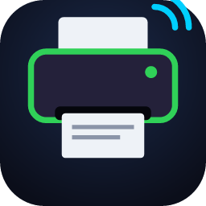
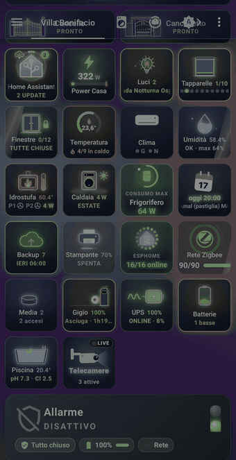

<p align="center"></p>

<h1 align="center">Remote Print for Home Assistant</h1>

<p align="center">
Upload a file from your phone — even when you are away from home — and your home printer prints it.<br>
<b>🇬🇧 English</b> · <a href="#-italiano">🇮🇹 Italiano</a>
</p>

<p align="center">
<a href="https://my.home-assistant.io/redirect/supervisor_add_addon_repository/?repository_url=https%3A%2F%2Fgithub.com%2FGapman1980%2Fha-remote-print"></a>
</p>

<p align="center"></p>

---

## What it does

- A page inside Home Assistant (sidebar entry **Print**): pick a file, choose copies, two-sided, fit to page, page ranges, tap **PRINT AT HOME**.
- Works from anywhere Home Assistant works (Nabu Casa, VPN, reverse proxy…): the file travels through Home Assistant **ingress**, nothing is exposed to the internet.
- Accepts **PDF, photos (JPG, PNG, HEIC from iPhone) and text**. Word/Excel: export them to PDF on the phone first.
- Live list of recent prints (*Queued → Printing… → Printed ✓*), cancel button, printer alerts (out of paper, toner low, door open).
- No printer driver needed: inside the add-on **CUPS** creates a *driverless* queue (IPP Everywhere / AirPrint) and converts files to the format your printer wants. Made for printers that **do not accept PDF directly** and whose vendor "print anywhere" cloud service is not available.
- Italian and English (follows the phone language).

## Requirements

- Home Assistant **OS** or **Supervised** (apps / add-ons are needed; not available on HA Container/Docker or Core).
- A network printer that supports **IPP / AirPrint** (almost every printer sold in the last 10 years: HP, Brother, Canon, Epson, Samsung, Kyocera…), **or** a Brother mono laser without AirPrint (see *Brother lasers* below). Give it a fixed IP address on your router.

## Installation

**One tap:** [](https://my.home-assistant.io/redirect/supervisor_add_addon_repository/?repository_url=https%3A%2F%2Fgithub.com%2FGapman1980%2Fha-remote-print)
→ confirm → search **Remote Print** in the store → Install. Or manually:

> ⚠️ Remote Print is an **app** (formerly called *add-on*). Add it from the **App store**, **not from the Marketplace**:
> the Marketplace only installs integrations and cards and answers *"…holds apps, the Marketplace does not install apps"*.

1. Home Assistant → **Settings → Apps → App store** → ⋮ (top right) → **Repositories**
   (older versions: **Settings → Add-ons → Add-on store**).
2. Add: `https://github.com/Gapman1980/ha-remote-print` → **Add** → close.
3. Find **Remote Print** in the store → **Install** (the first build takes a few minutes: it downloads CUPS).
4. **Configuration** tab → set **printer_uri** (see below) → **Save**.
5. **Info** tab → **Start**, turn on **Show in sidebar**.
6. Open **Print** from the sidebar, pick a file and print. 🎉

### Finding the printer address (`printer_uri`)

Most printers: `ipp://PRINTER-IP/ipp/print` (e.g. `ipp://192.168.1.100/ipp/print`).
If it does not work try `ipps://PRINTER-IP/ipp/print` or `ipp://PRINTER-IP/ipp`.
The **Log** tab tells you if the queue was created: `Queue RemotePrint ready`.

### Brother lasers without AirPrint (new in 1.1.0)

Some cheap Brother mono lasers (e.g. **DCP-1610W**, HL-1210W, MFC-1910W) print from the phone only with the Brother app and
have no AirPrint. For them set:

```yaml
printer_uri: socket://PRINTER-IP:9100
driver: brlaser
brother_model: DCP-1600   # part of the model name: DCP-1600 covers DCP-1610W/1612W
```

It uses the open source [brlaser](https://github.com/pdewacht/brlaser) driver. If the model is not found, the **Log** lists the
available ones. Paper/toner alerts are not available in this mode.

### Printers tested by users

Yours works? [Tell me here](https://github.com/Gapman1980/ha-remote-print/issues/new?template=2_works.yml) and it goes in the list.
Something wrong? [Open a problem report](https://github.com/Gapman1980/ha-remote-print/issues/new?template=1_problem.yml): it asks exactly what I need to help you.

| Printer | `driver` | `printer_uri` | `brother_model` | Result |
|---|---|---|---|---|
| HP LaserJet MFP M234dw | `driverless` | `ipp://IP/ipp/print` | – | ✅ works |
| Brother HL-1212W | `brlaser` | `socket://IP:9100` | `HL-1200` | ✅ works |
| Brother DCP-1612W | `brlaser` | `socket://IP:9100` | `DCP-1600` | ✅ works |
| Pantum (laser) | `driverless` | `ipp://IP/ipp` | – | ✅ works |
| Canon GX2000 series (GX2051, ink) | `driverless` | `ipp://IP/ipp/print` | – | ✅ works ([#1](https://github.com/Gapman1980/ha-remote-print/issues/1)) |
| Epson Expression Premium XP-960 (ink) | `driverless` | `ipp://IP/ipp/print` | – | ✅ works |
| Konica Minolta bizhub C3350i | `driverless` | `ipp://IP/ipp/print` | – | ✅ works (turn off the printer's **IP filter** or allow Home Assistant's IP, [#7](https://github.com/Gapman1980/ha-remote-print/issues/7)) |
| Brother DCP-L3550CDW (colour laser) | `driverless` | `ipp://IP/ipp/print` | – | ✅ works ([#8](https://github.com/Gapman1980/ha-remote-print/issues/8)) |
| Samsung M2070 Series (mono laser) | `driverless` | `ipp://IP/ipp/print` | – | ✅ works from **v1.6.0** (URF header fix, [#2](https://github.com/Gapman1980/ha-remote-print/issues/2)) |
| HP DeskJet 3760 (ink) | `driverless` | `ipp://IP/ipp/print` | – | ✅ works ([#9](https://github.com/Gapman1980/ha-remote-print/issues/9)) |

Tried another printer? Tell us in an [issue](https://github.com/Gapman1980/ha-remote-print/issues) (model + settings) and it will be added here.

### Options

| Option | Default | Meaning |
|---|---|---|
| `printer_uri` | `ipp://192.168.1.100/ipp/print` | IPP address of the printer (`socket://IP:9100` with brlaser) |
| `driver` | `driverless` | `driverless` (AirPrint / IPP Everywhere) or `brlaser` (Brother lasers without AirPrint) |
| `brother_model` | `DCP-1600` | brlaser only: part of the model name |
| `paper` | `A4` | A4, A5, Letter, Legal |
| `duplex_default` | `false` | "Two-sided" switch starts on |
| `keep_days` | `3` | uploaded files are deleted after N days |
| `language` | `auto` | `auto` (phone language), `en`, `it` |
| `lan_access` | `false` | also open the page directly from the local network (see below) |
| `allowed_users` | `[]` | Home Assistant usernames that can print without being administrators (see below) |
| `printer_name` | – | optional: name of the main printer on the page |
| `other_printers` | `[]` | optional: more printers to choose from on the page (see below) |

### More printers (new in 1.3.0)

**Configuration → ⋮ → Edit in YAML**, keep your printer and add the others:

```yaml
printer_name: HP Office
printer_uri: ipp://192.168.1.60/ipp/print
driver: driverless
other_printers:
  - name: Brother
    printer_uri: socket://192.168.1.70:9100
    driver: brlaser
    brother_model: HL-1200
```

Restart the add-on: the page shows a printer selector (remembered on each phone), paper/toner alerts follow the selected
printer and the job list shows where each job went. The first printer is the default.

### Print preview (new in 1.4.0)

After choosing a file tap **🔍 Preview and position**: you see the sheet with the printer's printable border (red dashes) and your page on it. Portrait / landscape, scale slider, **Fit**, **Center**, **100 %**, drag the page with a finger, arrows for the other pages of a PDF. What you see is what gets printed (adjustments apply to all pages). Without the preview, printing works as before.

## Dashboard (optional)

**Simple button** – [`examples/simple_button.yaml`](examples/simple_button.yaml): a normal Home Assistant button that opens the page.

**Animated printer card + popup** – [`examples/printer_card_popup.yaml`](examples/printer_card_popup.yaml):
a mini card with an animated printer (paper coming out while printing, toner bar, glow by state) and, on double tap, a popup with
toner level, pages left, printed pages, scans, misfeeds and an **UPLOAD FILE AND PRINT** button that opens the page *inside the popup*;
its **Back** button returns to the printer popup.

- Needs (HACS): [button-card](https://github.com/custom-cards/button-card), [browser_mod](https://github.com/thomasloven/hass-browser_mod), [card-mod](https://github.com/thomasloven/lovelace-card-mod).
- Set the three `variables` (in the mini card and in the popup): `prefix` (start of your printer's sensor ids), `status` and `name`. **Ink and toner levels are found automatically**: one animated bar per colour (black, cyan, magenta, yellow ...) for any printer added with the **IPP** integration (usually auto-discovered) or the HP Printer integration. Two looks: `style: bars` or `style: tubes` (one glass tube per cartridge with a moving liquid). To pick the entities yourself (order and names as you like, e.g. Italian names) fill `inks:` with entity ids or `{entity, name, color}`.
- Replace `YOUR_INGRESS_TOKEN` with the address shown in the add-on **Log**: `Ingress URL for the dashboard popup: /api/hassio_ingress/…/`.
- Administrators can always open the page; for other family members see *Non-admin users* below.

### Non-admin users (`allowed_users`, 1.5.0)

Add their Home Assistant **usernames** (Settings → People → Users) in the configuration, save and restart the add-on:

```yaml
allowed_users:
  - alisha
```

They open **Print** from the sidebar or the dashboard popup with their own login, at home and away (Nabu Casa too),
with no extra port. Anyone else sees a 🔒 *Not allowed* page. The **Print** entry appears in every user's sidebar
(Home Assistant shows an add-on panel to everyone or only to administrators); users can hide it.

### Local network only (`lan_access`)

1. **Configuration** → turn on `lan_access`; in **Network** write a port, e.g. `8099` → **Save** → restart the add-on.
2. Add a **Webpage** card with the URL `http://HOME-ASSISTANT-IP:8099/`.

⚠️ Only local network addresses are accepted, but **anyone on your Wi-Fi can print** and there is no password.
Never forward this port on your router. It works when Home Assistant is opened over plain `http://` at home:
a page opened over `https://` (Nabu Casa, reverse proxy) cannot embed an `http://` address.

## How it works

```
phone ──(HA app / browser)──► Home Assistant ingress ──► Remote Print add-on
                                                            │ CUPS driverless queue (IPP Everywhere)
                                                            │ PDF / JPG / PNG / HEIC / TXT → PWG / URF raster
                                                            ▼
                                                      network printer (IPP)
```

The web server only accepts requests coming from Home Assistant ingress (`172.30.32.2`); CUPS only listens inside the container.

## Troubleshooting

- **"Printer not reachable"**: check the IP and that the printer is on; wrong path → try the alternatives above.
- **Jobs stay "Queued"**: the printer is asleep or off; CUPS retries automatically when it comes back.
- **Nothing happens when tapping the card button**: open the page once from the sidebar, check the ingress token in the example.

---

## 🇮🇹 Italiano

**Remote Print** ti permette di stampare a casa un file che hai sul telefono, anche quando sei fuori.

### Come si presenta

Nella GIF in alto: popup della stampante → **CARICA FILE E STAMPA** → scelta del file → **STAMPA A CASA** → "Stampato ✓".

### Cosa fa
- Una pagina dentro Home Assistant (voce **Stampa** nel menu): scegli il file, copie, fronte/retro, adatta al foglio, pagine e premi **STAMPA A CASA**.
- Funziona ovunque funzioni Home Assistant (Nabu Casa, VPN…): il file passa dall'**ingress** di HA, niente porte aperte su internet.
- Accetta **PDF, foto (JPG, PNG, HEIC dell'iPhone) e testo**. Word/Excel: esportali prima in PDF dal telefono.
- Elenco delle ultime stampe con stato in tempo reale, annulla, avvisi della stampante (carta finita, toner, sportello aperto).
- Nessun driver: dentro l'add-on **CUPS** crea una coda *driverless* (IPP Everywhere / AirPrint) e converte i file nel formato della stampante. Pensato per le stampanti che **non accettano PDF diretti** e per cui il servizio cloud del produttore non funziona.

### Installazione
**Con un tocco:** [](https://my.home-assistant.io/redirect/supervisor_add_addon_repository/?repository_url=https%3A%2F%2Fgithub.com%2FGapman1980%2Fha-remote-print)
→ conferma → cerca **Remote Print** nello Store → Installa. Oppure a mano:

> ⚠️ Remote Print è un'**app** (prima si chiamavano *componenti aggiuntivi / add-on*). Va aggiunta dallo **Store delle app**, **non dal Marketplace**:
> il Marketplace installa solo integrazioni e card e risponde *"…holds apps, the Marketplace does not install apps"*.
> Serve Home Assistant **OS** o **Supervised** (non Container/Docker).

1. Home Assistant → **Impostazioni → App → Store delle app** → ⋮ in alto a destra → **Repository**
   (versioni meno recenti: **Impostazioni → Componenti aggiuntivi → Store**).
2. Aggiungi `https://github.com/Gapman1980/ha-remote-print` → **Aggiungi**.
3. Cerca **Remote Print** → **Installa** (la prima volta ci mette qualche minuto).
4. Scheda **Configurazione** → scrivi **printer_uri**, di solito `ipp://IP-STAMPANTE/ipp/print` → **Salva**.
5. Scheda **Info** → **Avvia** e attiva **Mostra nella barra laterale**.
6. Apri **Stampa** dal menu laterale, scegli un file e stampa. 🎉

Nel **Registro** dell'add-on deve comparire `Queue RemotePrint ready`. Se la stampante non risponde prova `ipps://IP/ipp/print` oppure `ipp://IP/ipp`. Dai alla stampante un IP fisso nel router.

### Laser Brother senza AirPrint (novità 1.1.0)
Alcune Brother laser economiche (es. **DCP-1610W**, HL-1210W, MFC-1910W) stampano dal telefono solo con l'app Brother. Per queste, in **Configurazione**:
- `printer_uri`: `socket://IP-STAMPANTE:9100`
- `driver`: `brlaser`
- `brother_model`: `DCP-1600` (parte del nome del modello; DCP-1600 va bene per DCP-1610W/1612W)

Usa il driver libero [brlaser](https://github.com/pdewacht/brlaser). Se il modello non viene trovato, il Registro elenca quelli disponibili. In questa modalità non ci sono gli avvisi carta/toner.

### Più stampanti (novità 1.3.0)
**Configurazione → ⋮ → Modifica in YAML**, lascia la tua stampante e aggiungi le altre:

```yaml
printer_name: HP Ufficio
printer_uri: ipp://192.168.1.60/ipp/print
driver: driverless
other_printers:
  - name: Brother
    printer_uri: socket://192.168.1.70:9100
    driver: brlaser
    brother_model: HL-1200
```

Riavvia l'add-on: nella pagina compare la scelta della stampante (ricordata su ogni telefono), gli avvisi carta/toner sono
quelli della stampante scelta e nella lista si vede dove è andata ogni stampa. La prima è quella predefinita.

### Anteprima di stampa (novità 1.4.0)
Dopo aver scelto il file tocca **🔍 Anteprima e posizione**: vedi il foglio con il bordo stampabile della stampante (tratteggio rosso) e la tua pagina. Verticale / orizzontale, cursore della scala, **Adatta**, **Centra**, **100%**, trascini la pagina col dito, frecce per le altre pagine del PDF. Quello che vedi è quello che esce (le regolazioni valgono per tutte le pagine). Senza anteprima si stampa come prima.

### Stampanti provate dagli utenti

La tua funziona? [Dimmelo qui](https://github.com/Gapman1980/ha-remote-print/issues/new?template=2_works.yml) e la aggiungo alla lista.
Qualcosa non va? [Apri una segnalazione](https://github.com/Gapman1980/ha-remote-print/issues/new?template=1_problem.yml): ti chiede esattamente quello che mi serve per aiutarti.

| Stampante | `driver` | `printer_uri` | `brother_model` | Esito |
|---|---|---|---|---|
| HP LaserJet MFP M234dw | `driverless` | `ipp://IP/ipp/print` | – | ✅ funziona |
| Brother HL-1212W | `brlaser` | `socket://IP:9100` | `HL-1200` | ✅ funziona |
| Brother DCP-1612W | `brlaser` | `socket://IP:9100` | `DCP-1600` | ✅ funziona |
| Pantum (laser) | `driverless` | `ipp://IP/ipp` | – | ✅ funziona |
| Canon GX2000 series (GX2051, inkjet) | `driverless` | `ipp://IP/ipp/print` | – | ✅ funziona ([#1](https://github.com/Gapman1980/ha-remote-print/issues/1)) |
| Epson Expression Premium XP-960 (inkjet) | `driverless` | `ipp://IP/ipp/print` | – | ✅ funziona |
| Konica Minolta bizhub C3350i | `driverless` | `ipp://IP/ipp/print` | – | ✅ funziona (disattiva il **filtro IP** della stampante o permetti l'IP di Home Assistant, [#7](https://github.com/Gapman1980/ha-remote-print/issues/7)) |
| Brother DCP-L3550CDW (laser a colori) | `driverless` | `ipp://IP/ipp/print` | – | ✅ funziona ([#8](https://github.com/Gapman1980/ha-remote-print/issues/8)) |
| Samsung M2070 Series (laser b/n) | `driverless` | `ipp://IP/ipp/print` | – | ✅ funziona dalla **v1.6.0** (correzione intestazione URF, [#2](https://github.com/Gapman1980/ha-remote-print/issues/2)) |
| HP DeskJet 3760 (inkjet) | `driverless` | `ipp://IP/ipp/print` | – | ✅ funziona ([#9](https://github.com/Gapman1980/ha-remote-print/issues/9)) |

Hai provato un'altra stampante? Scrivilo in una [issue](https://github.com/Gapman1980/ha-remote-print/issues) (modello + impostazioni) e la aggiungiamo.

### Card per la dashboard (facoltativa)
- `examples/simple_button.yaml`: pulsante semplice che apre la pagina.
- `examples/printer_card_popup.yaml`: mini card animata della stampante + popup con livelli inchiostro / toner e contatori, e pulsante **CARICA FILE E STAMPA** che apre la pagina *dentro il popup* (con **Indietro** torni al popup). Servono button-card, browser_mod e card-mod; imposta le tre `variables` (`prefix` = inizio dei nomi dei sensori, `status`, `name`): **i livelli di inchiostro / toner li trova da sola**, una barra animata per colore, con l'integrazione **IPP** (di solito trovata in automatico) o HP Printer; due stili, `style: bars` (barre) o `style: tubes` (provette con il liquido che ondeggia); per scegliere tu le cartucce, con nomi e ordine a piacere, compila `inks:` (id delle entità oppure `entity`/`name`/`color`); poi sostituisci `YOUR_INGRESS_TOKEN` con l'indirizzo scritto nel Registro dell'add-on.
- **Utenti non amministratori** (1.5.0): scrivi i loro **nomi utente** di Home Assistant in `allowed_users` (es. `- alisha`), salva e riavvia. Aprono **Stampa** dal menu laterale o dal popup con il loro accesso, anche fuori casa e senza porte aperte; gli altri vedono 🔒 *Non autorizzato*. La voce **Stampa** compare nel menu di tutti gli utenti (chi non serve la può nascondere).
- Solo rete di casa, senza utenti: attiva `lan_access`, metti una porta (es. `8099`) nella sezione **Rete**, riavvia l'add-on e usa una card **Pagina web** con `http://IP-HOME-ASSISTANT:8099/`. ⚠️ Niente password: chiunque sia sul tuo Wi-Fi può stampare; non aprire mai la porta sul router; funziona solo aprendo Home Assistant in `http://` da casa (non da `https://` / Nabu Casa).

---

MIT License · made with ❤️ for Home Assistant
